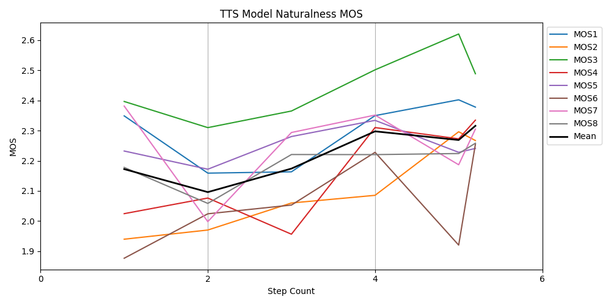

---
language:
- jp
tags:
- つくよみちゃん
- StyleBertVITS2
license: other
base_model:
- litagin/Style-Bert-VITS2-2.0-base-JP-Extra
---

# つくよみちゃんコーパス 学習モデル for Style-Bert-VITS2

[つくよみちゃんコーパス│声優統計コーパス（JVSコーパス準拠）](https://tyc.rei-yumesaki.net/material/corpus/)を使わせていただき、[Styl-Bert-VITS2](https://github.com/litagin02/Style-Bert-VITS2)で学習を行ったモデルです

# 学習パラメータ
* バッチサイズ : 4
* エポック数 : 200
* 何ステップごとに結果を保存するか : 1000
* bfloat16 : true
* プロセス数 : 72

# SpeechMOSによる自然性評価

# ライセンス
* ライセンスは、[つくよみちゃんコーパス│声優統計コーパス（JVSコーパス準拠）](https://tyc.rei-yumesaki.net/material/corpus/#terms3)に準じます